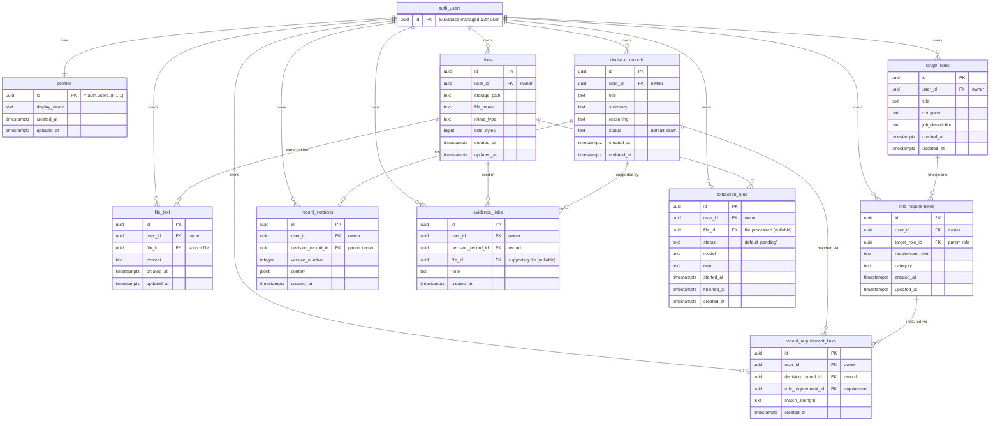

# Database schema — Career Evidence Agent

Entity-Relationship Diagram (ERD) of the Supabase Postgres schema created in E3
(Foundation). It is generated from the migration files in
[`supabase/migrations/`](../../supabase/migrations) and renders automatically on GitHub.

**Two things to know when reading it:**

- `auth_users` is Supabase's built-in authentication table (`auth.users`). The app does
  not create or own it; every application table links back to it.
- **Every application table carries a `user_id` and is protected by Row-Level Security
  (RLS)**, so a signed-in user can only ever read or write their own rows. `profiles` is
  the one exception to the column name: its primary key `id` *is* the user id (one
  profile per user). See [ADR-0003](../adr/0003-use-supabase-for-the-database-with-row-level-security.md).

Crow's-foot notation: `||` = exactly one, `o{` = zero-or-more (many).

## Tables at a glance

| Table | Purpose |
| --- | --- |
| `profiles` | One row per user account, keyed to the auth user; created automatically on sign-up. |
| `files` | Metadata for a user's uploaded documents (the bytes live in Supabase Storage, bucket `user-files`). |
| `file_text` | Text extracted from a file. |
| `target_roles` | A job the user is aiming for. |
| `role_requirements` | One requirement parsed from a target role. |
| `decision_records` | A piece of career evidence — the core record. |
| `record_versions` | History snapshots of a decision record. |
| `evidence_links` | Connects a decision record to a supporting file. |
| `record_requirement_links` | Maps a decision record to a role requirement (the gap check). |
| `extraction_runs` | A log of each text-extraction / processing job. |

## Storage

File bytes are not stored in a table. They live in a private Supabase Storage bucket,
`user-files`, under a per-user folder (`<user_id>/<filename>`), with storage policies
that mirror the RLS rules above — a user can only touch objects in their own folder. See
[`supabase/migrations/20261107202128_create_storage_bucket.sql`](../../supabase/migrations/20261107202128_create_storage_bucket.sql).
