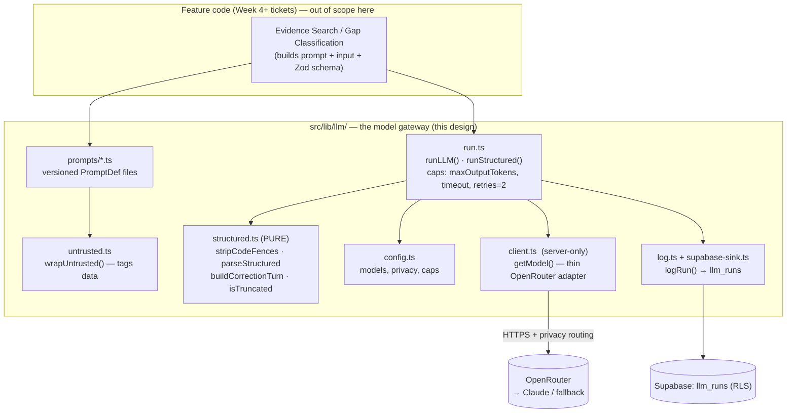

# Design — AI Foundation (OpenRouter model gateway)

> Status: **proposed** · Date: 2026-11-14 · Author: Amanda Wolf (with Claude Code)
> Build order: **6** (after E5 "Quality engineering foundation", before build-order 8
> "Evidence Search Pipeline v1"). Epic: **Foundation (all audiences)**.

## 1. Overview

Week 4 turns on the project's first LLM call. Per [ADR-0005](../adr/0005-defer-ai-agent-features-to-later-weeks-for-the-week-3-releas.md),
AI was deferred; the applicability matrix in [`.claude/rules/README.md`](../../.claude/rules/README.md)
marks the **Model Gateway as "ADAPTED — Week 4"** and the **R3 runtime defenses**
(`max_tokens`, timeout, retry caps 2–3, schema validation, defensive parse + ≤2-turn
self-correction) as **"ACTIVATES Week 4"**.

This design builds the **reusable AI foundation only** — the single server-side gateway
module, versioned prompts, Zod-validated structured-output helpers, server-only key
wiring, and run/cost logging — that the two Planned job-seeker tickets both depend on:

- **Evidence Search Pipeline v1** (build order 8)
- **Gap Classification** (build order 10)

It does **not** build those features, a chat UI, or retrieval/embeddings. A "token" is a
chunk of text the model bills by; a "schema" describes the exact shape of data we expect
back; "prompt injection" is untrusted text trying to pose as instructions to the model.

## 2. Goals and Non-Goals

### Goals

1. **One gateway, no side doors.** Every model call in the app goes through
   `src/lib/llm/` so keys, privacy routing, token caps, timeout, retries, and logging are
   set once and cannot be skipped (R3 "model gateway" equivalent; CLAUDE.md §4).
2. **R3 runtime caps on every call.** Explicit `maxOutputTokens`, a hard request timeout,
   and retry caps of 2 — plus truncation-aware handling of cut-off replies.
3. **Structured output the R3 way.** A Zod schema per model output; a **pure defensive
   parser** that strips markdown code fences before `safeParse`; and a **≤2-turn
   self-correction loop** that feeds the validation error back to the model. No "prompt
   begging".
4. **Testable by design.** The SDK/HTTP boundary stays thin and logic-free (Humble
   Object); all real logic (parser, fence-stripper, correction-prompt builder, truncation
   detector, cost mapper) lives in pure functions behind a typed interface (Dependency
   Inversion) so callers inject a fake in tests. ≥ 80% coverage on the pure modules.
5. **Secrets stay server-side.** `OPENROUTER_API_KEY` in server env only, never
   `NEXT_PUBLIC_`, never committed; placeholder added to `.env.example`; `client.ts`
   imports `server-only`.
6. **Privacy + injection defenses.** Privacy routing (`data_collection: "deny"`,
   `zdr: true`) on every request; untrusted text wrapped with `wrapUntrusted()`; career
   details never stored in production logs.
7. **Cost/run visibility.** One row per call in an `llm_runs` table (metadata always,
   prompt/reply text only in local dev), with RLS so a user reads only their own runs.

### Non-Goals (explicitly out of scope here)

- The Evidence Search Pipeline and Gap Classification features themselves.
- Retrieval / embeddings / pgvector (closed-rag skill; belongs to Evidence Search).
- A streaming chat UI (`/chat` route + page) — a later chatbot feature ticket, not a
  dependency of the two Planned tickets.
- Changing the existing deterministic matching in `src/lib/target-roles/` or
  `reference_items` data. The AI layer will upgrade retrieval later; untouched here.
- `ai-evals` answer-quality scoring (its own skill/ticket).

## 3. Architecture

A feature (later) composes a **prompt** + **input** and calls one of two entry points in
the gateway. `runLLM` is the thin call (chat or SDK-native structured output). `runStructured`
wraps it with the R3 defensive-parse + ≤2-turn self-correction loop for free-text replies.
Everything below `runLLM` is the humble boundary; everything in the pure helpers is unit-tested.



**Request flow for a structured call:** `runStructured` renders the prompt (untrusted
input already wrapped) → `runLLM` sends it through `getModel` with caps → raw text comes
back → `parseStructured` strips fences and `safeParse`s against the Zod schema → on
success, return typed data; on failure, if correction budget remains (≤2), append
`buildCorrectionTurn(rawText, zodError)` and retry; on exhaustion, throw a typed
`StructuredOutputError`. Every attempt writes one `llm_runs` row.

**Control-flow note (R3 §1 / anti-cargo-cult):** the self-correction loop is a small,
explicit, bounded TypeScript loop with a hard turn cap — *not* LangGraph, not an FSM
library. The agentic FSM/HSM machinery (R1) stays dormant until Week 6 per the matrix.

## 4. Technology Choices

| Choice | Why (plain language) | Alternative considered | Analogy |
|---|---|---|---|
| **OpenRouter** as the provider | One account and one key reach many models with built-in fallback, privacy routing, and a per-key credit cap — our "model gateway" without running a gateway service. | Call Anthropic's API directly. Rejected: no cross-provider fallback, no single cost cap, and a second provider later means a second integration. | A universal power adapter: one plug, many outlets, one fuse. |
| **Vercel AI SDK (`ai`)** | First-party, typed way to call models and request schema-validated structured output; handles retries/timeout; same SDK streams later if we add chat. | Hand-rolled `fetch` to OpenRouter. Rejected: we'd re-build retries, timeouts, structured-output parsing, and usage accounting ourselves. | A tested courier service instead of driving every parcel yourself. |
| **Zod** for output schemas | Already a dependency; turns "please return JSON" into a structural guarantee — invalid output throws instead of silently corrupting a feature (R3 §2, no prompt-begging). | Trust the prompt + `JSON.parse`. Rejected: brittle, the exact anti-pattern R3 forbids. | A parcel that won't close unless every item on the packing list is inside. |
| **Defensive parse + ≤2-turn self-correction** (our `structured.ts`) | R3 §2's recovery pipeline: strip code-fence noise cheaply, then give the model its own error back up to twice before giving up. Pure and fully unit-tested. | Rely solely on the SDK's native structured output. Kept native output as the primary path, but added this layer because chat replies and some providers return free/fenced text, and R3 mandates the feedback loop. | Spell-check that highlights the mistake and asks you to fix it, rather than rejecting the whole letter. |
| **`server-only` import in `client.ts`** | The build fails if any browser component imports the gateway, so the key can't leak to the client. | Rely on discipline / `NEXT_PUBLIC_` naming. Rejected: one mistake exposes the key. | A door that won't open from the outside. |
| **Supabase `llm_runs` table** | Answers "what did this cost and what failed?" per prompt version; reuses our Postgres + RLS so a user sees only their runs. | A SaaS observability tool, or no logging. Rejected: extra vendor/cost; we already have the DB. | An itemised phone bill you can actually read. |

**Models:** routed through OpenRouter to **Claude** (latest capable: Sonnet for chat,
a cheaper structured-output-capable model with a Claude fallback for extract). Exact
OpenRouter model ids are **confirmed with `check_models.py` before merge** (names change;
the ids shipped in the skill's `config.ts` are examples).

## 5. Data Model

One new table, applied as a Supabase migration. **No change to any existing table.**

```
public.llm_runs
  id            uuid pk
  user_id       uuid not null → auth.users(id) on delete cascade
  created_at    timestamptz default now()
  prompt_id     text not null         -- e.g. "gap-classify"
  prompt_version text not null        -- e.g. "1.0.0"
  model_requested text not null
  model_used    text
  status        text check in ('ok','error','invalid_output')
  input_tokens  integer
  output_tokens integer
  cost_usd      numeric(12,6)         -- from OpenRouter usage report
  latency_ms    integer not null
  error         text                  -- short, truncated
  input_text    text                  -- dev only (NODE_ENV≠production & LLM_LOG_TEXT=true)
  output_text   text                  -- dev only
```

- **RLS:** enabled. `select`/`insert` only `where auth.uid() = user_id`; no update/delete
  policy (append-only; account deletion cascades). Mirrors the ownership rule in
  [ADR-0003](../adr/0003-use-supabase-for-the-database-with-row-level-security.md) /
  [ADR-0007](../adr/0007-handle-user-career-data-with-a-privacy-by-default-policy.md).
- **Privacy:** production rows hold metadata only; prompt/reply text is withheld unless
  running locally with `LLM_LOG_TEXT=true`. Anonymous calls are console-logged, not stored.
- **Live push is gated:** the migration is applied **locally first with a dry-run**; the
  push to the hosted Supabase project happens **only after your explicit "yes"**.

## 6. Testing Strategy (TDD, pure logic first)

Written test-first with Vitest, following the existing `vitest.config.ts` pattern
(coverage measured on pure-logic modules only; 80% floor). New modules added to the
coverage `include` list:

- **`structured.ts` (the heart):** `stripCodeFences` (plain, ```json-fenced, ```-fenced,
  leading/trailing prose, nested backticks); `parseStructured` (valid → typed data;
  invalid shape → typed failure; non-JSON → typed failure); `buildCorrectionTurn`
  (includes the Zod issue path + message, echoes the bad output); `isTruncated`
  (finish-reason `length` vs `stop`).
- **`untrusted.ts`:** closing-tag escaping so wrapped text can't end its own block.
- **`config.ts` caps:** asserts `maxOutputTokens`, `timeoutMs`, `maxRetries ≤ 3` are set.
- **Gateway behaviour (fake OpenRouter, no key, no network):** mirrors the skill's
  `tests/llm/` — key sent only in the Authorization header, privacy routing present,
  fallback list sent, untrusted text wrapped, tokens/cost logged, **production log carries
  no text**, invalid output → `invalid_output` + throw, upstream 5xx retried then logged,
  a failing log sink never breaks the call, missing key → clear error. Plus a new case:
  **self-correction** — first reply fails the schema, second (corrected) reply passes, and
  exactly one extra turn was spent (budget respected).

CI additions (handed to ci-cd-setup, not built here): `test:llm`, `llm:check`,
`check_prompt_versions.py`.

## 7. Risks and Mitigations

| Risk | Mitigation |
|---|---|
| **Key leaks to the browser.** | `server-only` import; CI rule forbids `NEXT_PUBLIC_*KEY`; `.env.example` placeholder only; secrets-management hook (gitleaks) on commit. |
| **Runaway cost / infinite output.** | `maxOutputTokens`, timeout, `maxRetries=2`, self-correction capped at 2 turns, OpenRouter per-key credit limit (set in the dashboard). |
| **Prompt injection** from user/doc/DB text. | `wrapUntrusted()` tags + escapes; system prompt says tagged text is data; gateway gives the model **no tools that change data**. Reduces, not eliminates — documented. |
| **Career data sent to a training provider / stored in logs.** | `data_collection: "deny"`, `zdr: true`; OpenRouter privacy toggles off; no prompt/reply text in prod logs. |
| **Model id drifts / retires.** | `check_models.py` before merge and on a schedule; fallback model list; typed error surfaces a 404 clearly. |
| **Over-building toward R1/R2 machinery.** | Anti-cargo-cult clause: bounded TS loop, not LangGraph/FSM; no sagas/outbox. Logged as a conscious scope line in the ADR. |
| **Live DB migration surprises.** | Local apply + dry-run first; hosted push only on your explicit yes. |

## 8. Kanban cards

To be created in **CEA Backlog → Backlog**, Epic **Foundation (all audiences)**,
Type **Non-functional**, Build order **6**:

1. **AI foundation — ADR-0009: OpenRouter + Vercel AI SDK as the model gateway** — record
   the decision and its code-rules.
2. **AI foundation — gateway client module (config, client, run)** — single server-only
   OpenRouter client via the AI SDK with `maxOutputTokens`, timeout, `maxRetries=2`,
   fallback routing, behind a typed interface.
3. **AI foundation — versioned prompt files** — `prompts/types.ts` + one example
   `PromptDef`; prompts live in files, versioned (semver), never inline.
4. **AI foundation — Zod structured-output helpers (defensive parse + ≤2-turn
   self-correction)** — pure `structured.ts` (strip fences → `safeParse` → bounded
   correction loop), unit-tested to the 80% floor.
5. **AI foundation — server-only key wiring + injection/privacy defenses** —
   `OPENROUTER_API_KEY` server-only, `.env.example` placeholder, `server-only` import,
   `wrapUntrusted()`, privacy routing; security-review clean.
6. **AI foundation — `llm_runs` cost/run logging table + sink** — Supabase migration
   (RLS, append-only) and `supabaseSink`; local apply + dry-run, hosted push on explicit
   approval.

---

*Reply **"approved"** to approve this design and create the six cards above, or tell me
what to change.*
