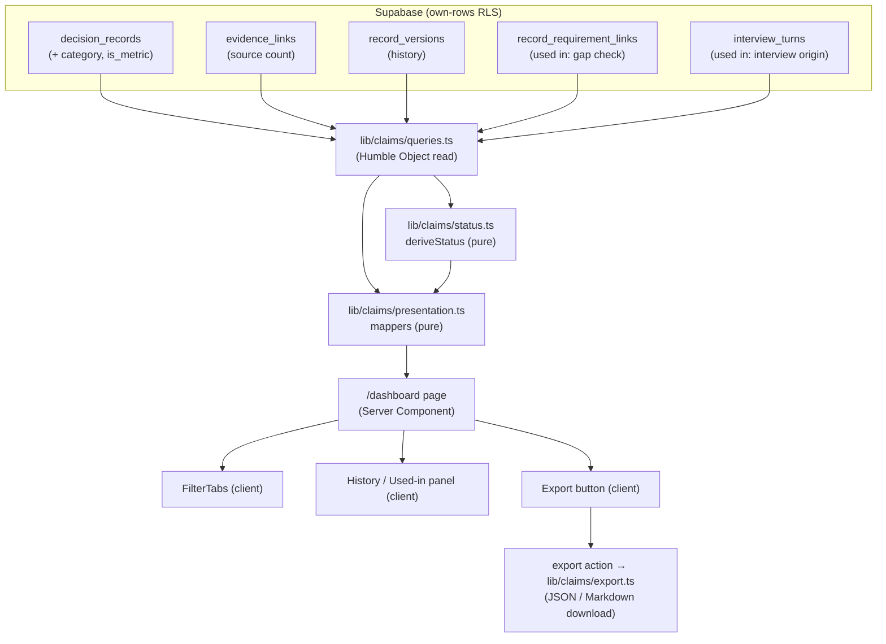

# Design — Claims / Evidence Profile

> The profile page (`/dashboard`) should match the Figma "Your evidence profile"
> prototype: a list of **claims**, each with a status chip, grouped by facet, with a
> history / "used in" side panel and an Export. This design builds that **from the data
> that already exists** — no new AI pipeline, no placeholder data.

## 1. Context and Problem Statement

The live profile page shows real data (display name, decision records, target roles)
styled to the prototype's look, but not its **information architecture**. The prototype's
"Your evidence profile" is a different shape:

- a summary line — *N confirmed claims · M sources · last updated …*
- an **Export** button
- **filter facet tabs** — All, Leadership, Delivery, Stakeholders, Technical
- **claim cards**, each with a status chip: *Evidence-linked*, *Your recollection*, or
  *Self-reported metric*
- a right-hand **history panel** — a claim's version history and where it is "used in".

There is no `claims` table, and the "Review claims" nav item is deliberately wired to
`href: null` (renders "Soon"). The user chose to **build the claims feature** (the true
match) rather than re-skin. Two hard constraints shape the solution:

- **No fake data.** Every count, chip, source, and history row must come from the user's
  real rows — nothing "coming soon" or invented ([CLAUDE.md], Week-3 materials).
- **No new AI.** [ADR-0005](../adr/0005-defer-ai-agent-features-to-later-weeks-for-the-week-3-releas.md)
  defers AI auto-extraction. Claims are formed from existing records / interview answers /
  evidence, or set by the user — not by a new LLM pipeline.

The costly-to-change question is **what a "claim" is**. The app already has
`decision_records` with `title`, the CDM fields (`situation`/`cue`/`decision`/`why`/
`outcome`), a `source` label (`artifact` | `self_reported`), **version history**
(`record_versions`), **evidence/source linking** (`evidence_links`), and **"used in"**
mapping (`record_requirement_links`, plus `interview_turns.decision_record_id`). That is
almost exactly a "claim". So the core decision (recorded in
[ADR-0015](../adr/0015-model-a-claim-as-a-projection-over-decision-records.md)) is to treat
a **claim as a projection over `decision_records`**, not a new parallel table.

## 2. Goals and Non-Goals

**Goals**

- Rebuild `/dashboard` to the prototype layout: summary line, facet tabs, claim cards with
  status chips, a history / "used in" side panel, and Export — all from real data.
- Derive each claim's **status** deterministically from real signals (has evidence files;
  user-marked metric), never guessed.
- Let the user set a claim's **facet/category** and **metric** flag, so the tabs and the
  "Self-reported metric" chip reflect their own choices (real, not inferred).
- Show **version history** (`record_versions`) and **"used in"** (gap-check requirement
  links + interview origin) for a selected claim.
- **Export** the user's claims as JSON and Markdown (download, server-generated).
- Own-rows RLS, SOLID/Humble-Object structure, Zod validation, tests to the 80% floor.

**Non-Goals**

- No AI auto-extraction of claims from files (deferred, ADR-0005). The separate "Review
  claims" AI-triage page stays "Soon"; this feature is the **profile view**, at `/dashboard`.
- No résumé-bullet generation. The prototype's "used in 1 résumé bullet" is future; we show
  the real usages that exist (interview origin, gap-check matches).
- No finer-than-record granularity: **one decision record = one claim** for now (splitting a
  record into multiple claims is a future option, noted in the ADR).
- No removal of working functionality. Display-name editing and target roles stay reachable
  (relocated to secondary sections, not deleted; a future Settings page may move them).

## 3. Architecture

A new `src/lib/claims/` module owns the claim concept; the page is a thin reader.
Boundaries follow CLAUDE.md §3: the Supabase read is a **Humble Object**, and all logic
(status derivation, mapping, export serialization) is **pure and unit-tested**.

- `types.ts` — Zod schemas + inferred types: `Claim`, `ClaimStatus`
  (`evidence_linked | recollection | self_reported_metric`), `ClaimCategory`
  (`leadership | delivery | stakeholders | technical`), `ClaimHistoryEntry`, `ClaimUsage`.
- `status.ts` — pure `deriveStatus({ sourceCount, isMetric })`: evidence present ⇒
  `evidence_linked`; else metric ⇒ `self_reported_metric`; else `recollection`.
- `queries.ts` — thin, RLS-scoped read assembling claims from `decision_records` joined to
  the source count (`evidence_links`), version count/history (`record_versions`), and
  usages (`record_requirement_links`, `interview_turns`). No business logic here.
- `presentation.ts` — pure mappers: claim → card props, status → `StatusChip` tone
  (evidence_linked→green, recollection→blue, self_reported_metric→orange), summary line.
- `export.ts` — pure serializers: `toJson(claims)` and `toMarkdown(claims)`.

The page (`src/app/dashboard/page.tsx`, a Server Component) calls `queries.ts`, maps with
`presentation.ts`, and renders the prototype layout with the existing `PageHeading`,
`StatusChip`, and `theme-tokens`. Interactive bits are small Client Components: the facet
**FilterTabs**, the **selected-claim** history panel, and the **Export** button (posts to a
Server Action / route that streams the serialized download).

## 4. Data Model

**Reuse `decision_records` as the claim aggregate.** One small **additive** migration adds
two nullable/defaulted columns; nothing existing changes, so no live data is touched and
RLS is inherited unchanged.

- `decision_records.category text` — the facet, constrained by a `CHECK` to
  `leadership | delivery | stakeholders | technical` (or `NULL` = unfiled). Mirrors how
  `source` is modelled (a text column + CHECK, widenable later), not a Postgres enum.
- `decision_records.is_metric boolean not null default false` — the user's mark that a
  claim is a self-reported number (e.g. "Reduced invoice errors by 30%").

**Status is derived, never stored** (a stored status would drift from the evidence):

| Signal | Derived status | Chip |
| --- | --- | --- |
| ≥ 1 `evidence_links` row with a file | `evidence_linked` | Evidence-linked (green) |
| no evidence, `is_metric = true` | `self_reported_metric` | Self-reported metric (orange) |
| no evidence, `is_metric = false` | `recollection` | Your recollection (blue) |

**Derived, read-only, from existing rows:** source count = `count(evidence_links)`; distinct
source files for the summary line; `last updated` = `max(updated_at)`; history =
`record_versions` ordered by `version_number`; "used in" = `record_requirement_links`
(gap-check matches) and whether an `interview_turns` row points at the record (interview
origin). RLS on all of these is already own-rows; the two new columns inherit the table's
policies. The migration is pushed through the `supabase-data` confirm flow (dry run → apply)
against the linked project.

## 5. Technology Choices

- **A claim is a projection over `decision_records`, not a new table.** *Plain reason:* the
  record already holds the title, text, source, history, evidence, and usage a claim needs —
  a second table would be a duplicate with two sources of truth. *Alternative considered:* a
  dedicated `claims` table (rejected: duplication, sync bugs, violates "one aggregate owns
  its data"). *Analogy:* a "claim" is a lens you look at a decision record through, not a
  separate filing cabinet. (See [ADR-0015](../adr/0015-model-a-claim-as-a-projection-over-decision-records.md).)
- **Status computed on read, not stored.** *Plain reason:* the status is a fact *about* the
  evidence; computing it means it can never disagree with the files. *Alternative:* a stored
  `status` column updated on every evidence change (rejected: easy to desync, extra writes).
  *Analogy:* a thermometer reads the temperature now rather than trusting a note taped to the
  wall. Matches [ADR-0012](../adr/0012-present-gap-verdicts-in-three-buckets-computed-on-demand.md)
  (gap verdicts computed on demand).
- **Zod for the claim + export shapes.** *Plain reason:* one source of truth for the types,
  validated at the boundary. *Alternative:* hand-written TypeScript interfaces (rejected: no
  runtime validation). *Analogy:* a passport checked at the gate, not just claimed.
- **Reuse `PageHeading` / `StatusChip` / `theme-tokens` (MUI).** *Plain reason:* the
  prototype's look is already encoded in these; reuse keeps it consistent and is less code.
  *Alternative:* bespoke components per page (rejected: drift, duplication). *Analogy:* build
  with the same bricks the rest of the house uses.
- **Export = server-generated JSON/Markdown download.** *Plain reason:* the data is rendered
  server-side under the user's own session (RLS) and streamed to their browser — it never
  goes to a third party. *Alternative:* a client-side scrape of the DOM (rejected: fragile,
  incomplete) or emailing a file (rejected: sends data out, ADR-0007). *Analogy:* printing
  your own file at home rather than mailing it to a print shop.

## 6. Security and Privacy

- **Own-rows RLS** already guards every source table (`decision_records`, `evidence_links`,
  `record_versions`, `record_requirement_links`, `interview_turns`); the two new columns
  inherit `decision_records`' policies. All reads go through the RLS-scoped server client, so
  a user only ever sees their own claims (ADR-0003, ADR-0007).
- **Export** is generated server-side from the user's own rows and returned as a download to
  that same user; nothing is sent to any third party, consistent with
  [ADR-0007](../adr/0007-handle-user-career-data-with-a-privacy-by-default-policy.md)
  (privacy-by-default, no data leaves the system). No LLM call is involved, so no career data
  reaches an external model.
- **Mutations** are edits to existing `decision_records` (setting `category` / `is_metric`)
  — absolute-overwrite updates, naturally idempotent (CLAUDE.md rule 7); they re-check auth
  in the Server Action and are RLS-scoped. No count-like/money-like state is introduced, so no
  Request-ID/dedupe table is needed.
- `security-review` runs before hand-off because this touches data storage and a new column
  with a CHECK constraint.

## 7. Testing Strategy

TDD on the pure logic first, mirroring the interview/gap modules (canned inputs, no network):

- **`status.ts`** — `deriveStatus` across all three branches, plus the edge that evidence
  present wins over `is_metric = true`.
- **`presentation.ts`** — status→tone mapping, card-prop mapping, the summary line
  (singular/plural, zero claims, distinct-source counting).
- **`export.ts`** — `toJson` / `toMarkdown` golden outputs, including empty and
  special-character cases.
- **`types.ts`** — Zod acceptance/rejection for `ClaimCategory` and `ClaimStatus`.
- **`queries.ts`** — a boundary test (tsx + a fake Supabase, like
  `tests/interview/`) asserting the assembly of counts/history/usages and RLS scoping shape.

New pure files are added to the vitest coverage `include` list; the **80% floor** is the
enforced gate (CLAUDE.md §3.5). No fake data beyond canned test inputs.

## 8. Kanban cards

- **Claims data model migration** — additive migration adding `category` (CHECK) and
  `is_metric` to `decision_records`; RLS inherited; pushed via the supabase-data confirm flow.
- **Claims domain module** — `types.ts` (Zod) + pure `status.ts` (`deriveStatus`) +
  `presentation.ts` mappers, unit-tested first.
- **Claims query layer** — RLS-scoped `queries.ts` assembling claims with source count,
  version history, and "used in" (gap links + interview origin); boundary-tested.
- **Evidence profile page rebuild** — rebuild `/dashboard` to the prototype: summary line,
  facet FilterTabs, claim cards with status chips, history/used-in side panel; reuse
  `PageHeading`/`StatusChip`/tokens; keep display-name + target roles as secondary sections.
- **Claim facet + metric editing** — add `category` and `is_metric` inputs to the
  decision-record form so facets and the metric chip are real, user-set data.
- **Export evidence profile** — pure JSON + Markdown serializers and the download action/route.
- **Tests & CI** — unit + boundary tests to the 80% floor; wire new pure files into coverage;
  self-review + security-review before the PR.
