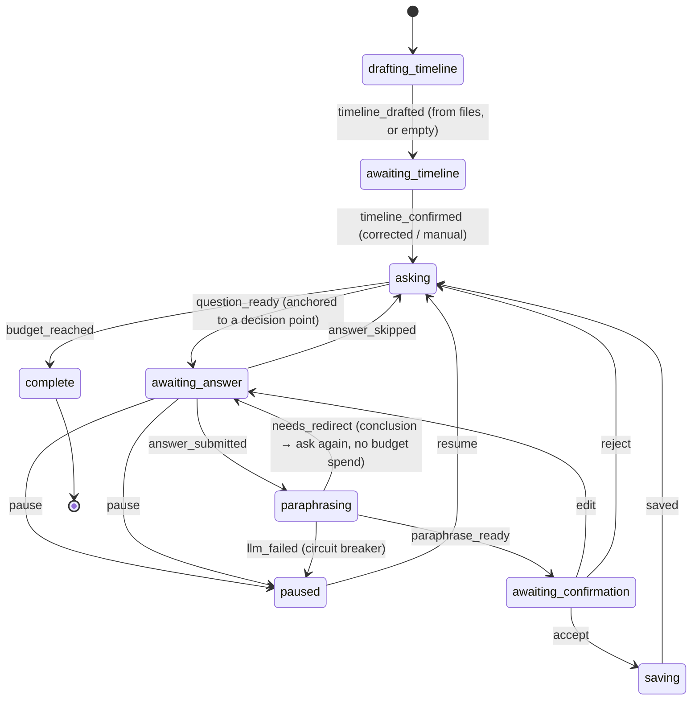

# Decision-Point Interview (timeline-anchored CDM interview)

Completes the job-seeker **Reasoning Interview & Verified Records** epic. The existing
[Reasoning Interview](reasoning-interview.md) already runs a Critical Decision Method loop —
one grounded question at a time, a play-back, and a human-gated save into `decision_records`.
This card adds the one thing it is missing from the backlog spec: it **anchors the interview
to a project timeline built from the user's own files**, so the questions are about *that
project's* real decision points rather than only about retrieved reference snippets.

It reuses the model gateway ([ADR-0009](../adr/0009-use-openrouter-and-the-vercel-ai-sdk-as-the-model-gateway.md)),
retrieval ([ADR-0010](../adr/0010-use-pgvector-for-closed-rag-retrieval-over-reference-and-evidence.md)),
Projects + files ([ADR-0019](../adr/0019-add-projects-as-a-cross-cutting-organising-entity-and-file-detail-hub.md)),
and the existing interview FSM, orchestrator, and `decision_records` save path. The new
decisions are recorded in **ADR-0021**; they are additive to **ADR-0013** (the FSM) and
**ADR-0014** (session/turn persistence).

## What this card adds (and what it reuses)

New in this card:

- **A drafted project timeline (AC1).** From the files of a chosen project, order events by
  date and parse version hints from filenames, producing a reviewable list of decision points.
- **A correction step (AC2).** The user edits, reorders, removes, or adds timeline entries
  *before* the interview proceeds. The corrected timeline is the ground truth for questions.
- **Decision-point grounding (AC3).** Each question is anchored to one timeline entry and asks
  what the user *noticed* and *expected* at that point (CDM cue + situation).
- **Guide-back-from-conclusions (AC4).** When an answer is a conclusion ("it went well")
  rather than what happened, the agent re-asks the same question with a redirect — and does
  **not** spend a question from the budget.
- **Manual-timeline fallback (AC6).** When no files have usable dates, the user builds the
  timeline by hand instead of being blocked.

Reused unchanged (already built and tested):

- The **5–8 question cap** (AC5) — the existing `questionBudget` (default 6, hard cap 10);
  this feature starts sessions with a budget of **8**.
- **End-early keeps captured data** (AC7) — records are saved incrementally on `accept`, and
  `pause` leaves the session resumable; nothing already saved is lost.
- **RLS** (AC8) — own-rows policies on `interview_sessions`/`interview_turns` and on `files`.
- The **HITL save gate**, **circuit breaker**, paraphrase/extract, and the
  `saveDecisionRecord` + evidence-indexing path.

## Approach: a pre-interview timeline phase + one FSM branch

Two deliberate boundaries keep the audited, 100%-covered interview FSM stable:

1. **The timeline is a pre-interview setup phase, not a loop state.** Drafting and correcting
   the timeline happen *before* the question loop starts. The corrected timeline is persisted
   on the session and passed into the loop as grounding context. This keeps the budget/HITL
   proofs in `machine.ts` untouched by timeline concerns.
2. **The only change to the question loop is the conclusion→redirect branch**, added as a
   single new event with its own guard and tests — small, bounded, and provably budget-neutral.

- **New states:** `drafting_timeline` (orchestrator builds the timeline) and
  `awaiting_timeline` (user corrects it). They sit *before* `asking`; the question loop from
  `asking` onward is unchanged except for the one redirect edge.
- **New event:** `needs_redirect` — emitted by the orchestrator when the answer-classification
  says the answer is a conclusion, not an account of events. It routes `paraphrasing →
  awaiting_answer` with a redirect note, **without** incrementing `askedCount` (mirrors how
  `edit` re-asks without re-counting). A pure test asserts the budget is unchanged.
- **Guards unchanged:** `budget_reached` (default 8, hard cap 10) and the `llm_failed` circuit
  breaker behave exactly as today.

## The timeline

### Where it comes from (AC1, AC6)

A **project** ([ADR-0019](../adr/0019-add-projects-as-a-cross-cutting-organising-entity-and-file-detail-hub.md))
is chosen when the interview starts; its files are the raw material. `files` gives
`created_at`, `file_name`, `caption`, and `project_id`. The pure drafter:

1. Orders the project's files by `created_at`.
2. Parses **version hints** from filenames (`v1`, `v2`, `draft`, `final`, `rev3`, dates in the
   name) to group a file's revisions into one decision point and label progression.
3. Emits a `Timeline` — an ordered list of `TimelineEntry { id, label, date, fileIds[],
   versionHint }`.
4. If **no file has a usable date** (or the project has no files), returns an **empty**
   timeline; the UI then offers manual entry (AC6).

> **Honest limitation, stated in the UI:** `files.created_at` is the *upload* date, not
> necessarily when the work happened. That is exactly why the correction step (AC2) exists —
> the user fixes dates and labels before any question is asked. No date is ever invented.

### Correction and persistence (AC2)

The drafted timeline is shown for review; the user edits labels/dates, removes noise, and adds
entries (including the fully-manual case). The **corrected** timeline is persisted on the
session as `timeline jsonb` and is the single source the questions anchor to. Because the
session is the checkpoint (ADR-0014), pause/resume reloads the confirmed timeline — the user
never re-corrects it.

## Grounding & honesty

- **Questions** are anchored to one timeline entry and ask what the user *noticed* and
  *expected* at that point. The question prompt is given the entry (label/date) and, where a
  cited snippet exists, a retrieved file snippet — `wrapUntrusted` on both (OWASP LLM01). With
  no snippet it still asks an open CDM question about that decision point; it never invents
  file contents.
- **Answer classification** is a small structured check: is the answer *an account of what
  happened* or *a conclusion*? A conclusion triggers `needs_redirect`; an account proceeds to
  the paraphrase. The classification returns data only — no side effects, validated by Zod.
- **Paraphrase** is unchanged: a strict `extract` mapping the user's words to the CDM draft,
  never adding facts; saved as `source = self_reported` until a file supports it.
- The model has **no side-effecting tools**; every save is gated on an explicit `accept`.

## Modules

| File | Kind | Responsibility |
|---|---|---|
| `src/lib/interview/timeline.ts` | pure (coverage) | `draftTimeline(files)`, filename version/date parsing, `Timeline`/`TimelineEntry` Zod schemas, manual-entry validation; no-dates → empty |
| `src/lib/interview/types.ts` | pure (coverage) | Add `drafting_timeline` + `awaiting_timeline` states, `timeline_drafted`/`timeline_confirmed`/`needs_redirect` events, `timeline` on state |
| `src/lib/interview/machine.ts` | pure (coverage) | Add the two pre-loop transitions + the budget-neutral `needs_redirect` edge; existing guards untouched |
| `src/lib/llm/prompts/interview-question.ts` | pure (coverage) | Extend to anchor a question to a timeline entry (versioned bump) |
| `src/lib/llm/prompts/answer-classify.ts` | pure (coverage) | New versioned `extract` prompt: account-of-events vs conclusion; `wrapUntrusted` |
| `src/lib/interview/orchestrator.ts` | boundary, `server-only` (tsx test) | Draft timeline from project files, drive timeline confirm, feed the entry into question grounding, emit `needs_redirect`; save path unchanged |
| `src/lib/interview/queries.ts` | thin read | Load the persisted `timeline` with the session |
| `src/app/dashboard/interview/` | boundary + client | Timeline review/correct step (edit, add, manual), then the existing conversation UI; new Server Actions `confirmTimeline` |

Mirrors the existing pure-core vs `server-only`-boundary split. One model path (reuses
`runLLM`/`runStructured`, `wrapUntrusted`, `llm_runs`); one database.

## Persistence (additive to ADR-0014)

One additive column, no new table, RLS unchanged:

- **`interview_sessions.timeline jsonb` (nullable)** — the user-confirmed timeline. Null until
  confirmed; set when the user leaves `awaiting_timeline`. A `project_id` column (nullable,
  FK to `projects`) records which project the timeline was built from.

Migration is additive. `supabase db push --dry-run` runs locally only; the hosted push happens
**only on your explicit yes** (per [supabase-data] convention — the last several migrations
followed the same gate).

## Testing

- **Timeline core** unit-tested to 100%: ordering by date, version-hint parsing, grouping
  revisions, the no-usable-dates → empty case, and manual-entry validation.
- **Machine** stays at 100%: the two new pre-loop transitions, and critically that
  `needs_redirect` returns to `awaiting_answer` **without** changing `askedCount`
  (budget-neutral), with the HITL isolation and budget/breaker proofs re-run intact.
- **Prompts** tested for versioned id/semver, the anchor/never-invent rules, `wrapUntrusted`.
- **Orchestrator** (`server-only`) via `tsx --conditions=react-server` with fake files/model/
  repo: a drafted timeline from fake files, a conclusion answer producing a redirect (no new
  turn counted), and a decision record written **only after** `accept`.

## Kanban cards

1. **ADR-0021 — timeline-anchored CDM interview** — record the pre-interview timeline phase,
   the conclusion→redirect branch, and the additive persistence; note it extends ADR-0013/0014.
2. **Timeline core** — `interview/timeline.ts` + schemas, test-first to 100% (draft from files,
   version/date parsing, no-dates → empty, manual-entry validation).
3. **Timeline persistence** — additive `timeline jsonb` + `project_id` on `interview_sessions`
   migration + `queries.ts` load; RLS unchanged; dry-run local, hosted push gated.
4. **FSM: timeline phase + redirect branch** — add the two pre-loop states/events and the
   budget-neutral `needs_redirect` edge to `types.ts`/`machine.ts`, test-first (budget proof).
5. **Prompts** — anchor the question prompt to a timeline entry (version bump) + new
   answer-classification `extract` prompt, versioned + tests.
6. **Orchestrator wiring** — draft timeline from project files, `confirmTimeline`, feed the
   entry into grounding, emit `needs_redirect`; tsx boundary test (save only on accept).
7. **Timeline review UI** — the review/correct/manual step in `/dashboard/interview` + the
   `confirmTimeline` Server Action; accessible, themed; then the existing conversation UI.
