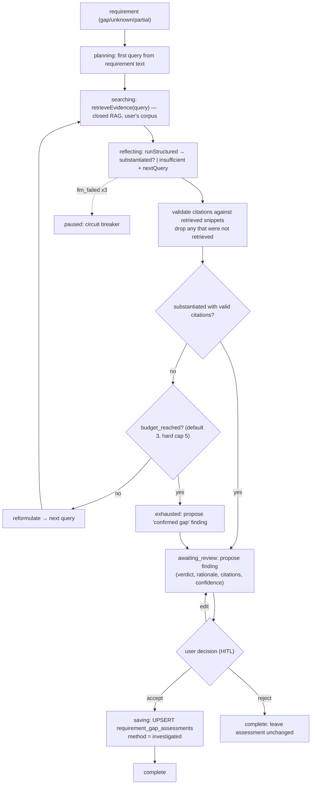

# Evidence Investigation Agent (build order 14)

The agentic deepening of the job-seeker **Evidence vs. Requirements Gap Check**, and the
last feature of that epic. The one-shot Gap Classification
([ADR-0011](../adr/0011-classify-evidence-against-role-requirements-with-a-grounded-four-verdict-schema.md))
retrieves **once** per requirement and classifies it. When relevant evidence exists in the
user's corpus but is phrased differently from the requirement, a single query misses it and
the requirement is reported as `gap` or `unknown`. The Evidence Investigation Agent runs a
**bounded ReAct-style retrieval loop** for one requirement at a time: it reformulates the
search query, retrieves again (closed RAG), reflects on whether the retrieved evidence
substantiates the requirement, and iterates up to a small step cap — then **proposes** a
grounded finding the user reviews. Only on an explicit **accept** does it update that
requirement's assessment.

It consumes the model gateway
([ADR-0009](../adr/0009-use-openrouter-and-the-vercel-ai-sdk-as-the-model-gateway.md)) and
retrieval
([ADR-0010](../adr/0010-use-pgvector-for-closed-rag-retrieval-over-reference-and-evidence.md)),
reuses the Gap Check's `requirement_gap_assessments` store, and follows the agent pattern
established by the Reasoning Interview
([ADR-0013](../adr/0013-model-the-reasoning-interview-as-an-explicit-fsm.md)). The modelling
decision is recorded in **ADR-0017**.

## Why an agent here (and not just a second query)

This is the **second agent / multi-step loop** in the app. The R1 (FSM/HITL/caps) and the
Week-6 half of R3 rows of the [applicability matrix](../../.claude/rules/README.md) are
already **ACTIVE** (flipped by ADR-0013). A loop that searches → reflects → reformulates →
searches again, turn after turn until it finds substantiating evidence or a budget is spent,
is exactly their shape, so this feature is built to the same FSM/HITL/caps standard as the
interview — no ad-hoc `while` loop, no LangGraph.

Scope is deliberately narrow to keep cost and error bounded:

- **One requirement at a time**, triggered by the user from the Gap Check screen — not a
  bulk auto-run over every requirement (that multiplies model cost and compounding error, R3 §1).
- Only offered for requirements the one-shot check left as `gap`, `unknown`, or `partial`;
  a `met` requirement has nothing to investigate.
- The agent **never invents evidence** (closed RAG): every citation it proposes is validated
  against really-retrieved snippets, exactly as Gap Classification does.

## The loop (per requirement)

States (`InvestigationState`, a discriminated union): `planning · searching · reflecting ·
awaiting_review · saving · exhausted · paused · complete`. A pure `reduce(state, event)`
router performs every transition; the orchestrator performs the side effects and feeds each
result back as the next event — identical to the interview's split.

**HITL isolation (R1 §3.4), structural.** `saving` is reachable **only** from
`awaiting_review` on `accept`. The agent can surface candidate evidence all day; it cannot
change a single assessment row without the user's explicit "accept". A unit test asserts no
other transition reaches `saving` (mirrors the interview's proof).

**Bounded (R1 §3.5, R3 §1).** A pure `budget_reached` guard stops after `searchBudget`
searches (default 3, hard cap 5). A `llm_failed` event increments a failure counter; after 3
consecutive failures a circuit breaker degrades the loop to `paused` rather than retrying
forever. Every model call still carries the gateway's per-call caps (`maxOutputTokens`,
`timeoutMs`, ≤2 correction turns) from ADR-0009 — unchanged.

## Modules

| File | Kind | Responsibility |
|---|---|---|
| `src/lib/investigation/types.ts` | pure (coverage) | Zod: `InvestigationState` / `InvestigationEvent` unions, the reflection model-output schema (`substantiated \| insufficient`, `nextQuery`, `verdict`, `rationale`, `citations[]`, `confidence`), and the `Finding` shape |
| `src/lib/investigation/machine.ts` | pure (100% target) | `createInvestigation` (clamps budget to hard cap), `budgetReached` guard, circuit breaker, pure `reduce(state, event)` router |
| `src/lib/llm/prompts/investigation-reflect.ts` | pure (coverage) | Versioned grounded `PromptDef`: given the requirement + retrieved snippets, decide sufficiency and, if insufficient, propose a reformulated query; `wrapUntrusted()` on evidence + requirement (OWASP LLM01) |
| `src/lib/investigation/orchestrator.ts` | boundary, `server-only` (tsx test) | Drives the FSM: `retrieveEvidence`, `runStructured` reflect call, citation validation, the gated UPSERT; injected deps; Server Action entry points (`startInvestigation`, `acceptFinding`, `editFinding`, `rejectFinding`) |

Mirrors the interview's `machine.ts` (pure) vs `orchestrator.ts` (boundary) split and the
`gap/classify.ts` citation-validation helpers. **No second model path**: reuses
`runStructured`, `wrapUntrusted`, `supabaseSink`, `llm_runs`. Retrieval and gateway are not
modified. Citation validation reuses the `validateCitations` / `resolveVerdict` logic shape
from `gap/classify.ts` (extract to a shared pure helper if it is cleaner than duplicating).

## Persistence

Reuse **`requirement_gap_assessments`** (Gap Check's own-rows-RLS table) — no new table in
the MVP. One **additive** migration adds provenance columns:

- `method text not null default 'one_shot'` — `'one_shot' \| 'investigated'`
- `confidence text` — nullable; the agent's self-reported confidence for an investigated finding
- `search_count int` — nullable; how many searches the investigation spent (audit)

Idempotency (CLAUDE.md rule 7): the save is an **UPSERT** keyed on `role_requirement_id` —
natural idempotency via absolute overwrite (`SET verdict = …`), so a repeated or late `accept`
cannot create a duplicate row. No new constraint is needed: `requirement_gap_assessments`
already declares `role_requirement_id UNIQUE` (migration `20261114140000`), which is stricter
than the composite key the earlier draft assumed and is exactly the upsert target. The
migration is run with `supabase db push --dry-run` locally only; the hosted push happens
**only on the user's explicit yes**. Every model call is already logged to `llm_runs`,
so no separate investigation-audit table is built now (possible follow-up).

## UI

An **Investigate** affordance on the Gap Check screen (screen 04) for each requirement whose
verdict is `gap`, `unknown`, or `partial`. Pressing it starts one investigation; the loop runs
server-side and returns a **proposed finding** — the suggested verdict, rationale, candidate
citations (with titles from the retrieved sources), and confidence — rendered in an accessible
MUI review panel. The user **accepts** (updates the assessment), **edits** (adjusts before
accepting), or **rejects** (leaves the assessment unchanged). Themed and accessible per the
design system (WCAG 2.2 AA), reusing the Gap Check components.

## Guardrails in force (applicability matrix)

| Rule | How this feature satisfies it |
|---|---|
| R1 FSM/HSM | Explicit discriminated-union state + pure `reduce` router; no ad-hoc branching, no LangGraph |
| R1 §3.4 HITL isolation | `saving` reachable only from `awaiting_review` on `accept`; proven by test |
| R1 §3.5 caps + breaker | Pure `budget_reached` guard (default 3, hard cap 5) + consecutive-`llm_failed` circuit breaker |
| R3 §1 execution caps | Per-call `maxOutputTokens` / `timeoutMs` / ≤2 correction turns via the ADR-0009 gateway |
| R3 §2 schema validation | `runStructured` + Zod reflect schema, defensive parse, ≤2 self-correction turns |
| Closed RAG (ADR-0010/0011) | Citations validated against retrieved snippets; a substantiated verdict with no valid citation is downgraded to `gap` |
| CLAUDE.md §3 SOLID/DI/Humble Object | Pure FSM + injected deps; the thin orchestrator is the only module that touches network/DB |
| CLAUDE.md rule 7 idempotency | UPSERT on the natural key; absolute-overwrite natural idempotency |

## Testing

Pure modules (`types.ts`, `machine.ts`, the reflect prompt, citation validation) are
unit-tested with Vitest, injecting fake retrieval + fake model functions to exercise every
branch: no-evidence, invented citation dropped, substantiated-then-accept, insufficient →
reformulate → substantiated, budget exhausted → confirmed gap, breaker trip, and — critically
— that **no transition other than `accept` reaches `saving`**. The guards and the HITL edge
are covered to 100%; the module overall to the 80% floor. The `server-only` orchestrator is
tested via `tsx --conditions=react-server` under `tests/investigation/` with a mock Supabase +
mock model, asserting an assessment row is written only after `accept`, and that the UPSERT is
idempotent under a repeated accept — same approach as `tests/interview/` and `tests/gap/`.

## Kanban cards

1. **ADR-0017: Evidence Investigation Agent as a bounded ReAct retrieval FSM** — record the loop model, HITL gate, caps, and closed-RAG grounding; note it reuses the interview pattern.
2. **Investigation types + machine (pure FSM)** — `investigation/types.ts` + `investigation/machine.ts`, test-first; 100% on guards and the HITL edge.
3. **Investigation reflect prompt** — versioned grounded prompt file (sufficiency + query reformulation), `wrapUntrusted`, tests.
4. **Investigation orchestrator boundary** — `investigation/orchestrator.ts` wiring retrieval + `runStructured` + gated UPSERT + Server Actions; tsx boundary test incl. "no save without accept" and idempotent accept.
5. **Assessment provenance migration** — additive `method` / `confidence` / `search_count` columns (the upsert reuses the existing `role_requirement_id` UNIQUE; no new constraint) (dry-run local; hosted push gated on explicit yes).
6. **Gap Check "Investigate" UI** — accessible MUI review panel + accept/edit/reject Server Actions on screen 04, for gap/unknown/partial requirements.
