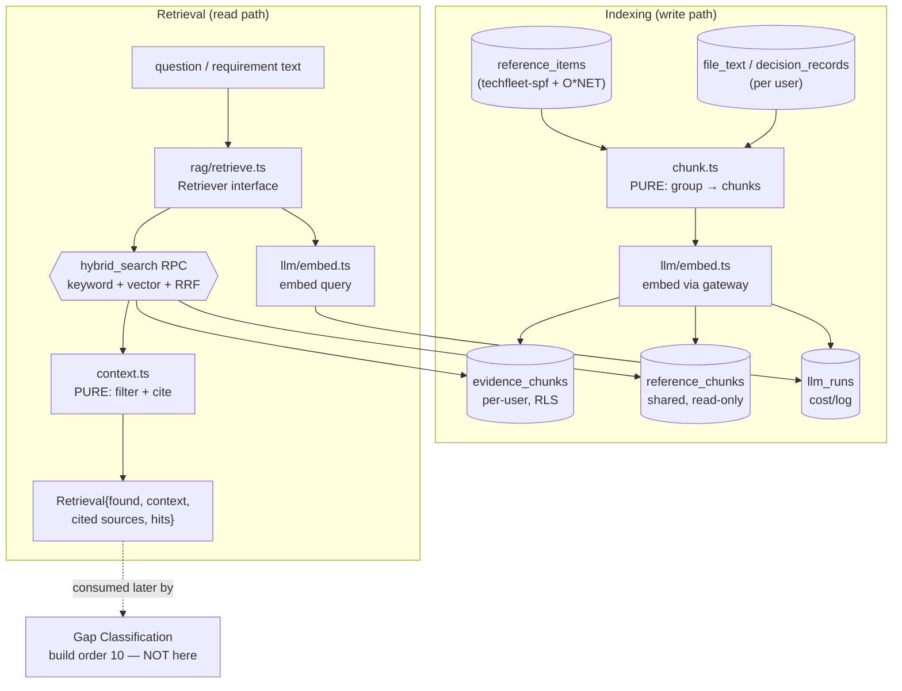

# Design — Evidence Search Pipeline v1 (closed-RAG retrieval)

> Status: **proposed — awaiting "approved"**. Build order 8, Epic "Job seekers · Epic 1:
> Evidence vs. Requirements Gap Check". Feeds Gap Classification (build order 10), which is
> **not** built here. New tech (embeddings + pgvector), so this is a full design + ADR
> ([ADR-0010](../adr/0010-use-pgvector-for-closed-rag-retrieval-over-reference-and-evidence.md)).

## 1. Context and Problem Statement

Gap Check compares a job-seeker's **target-role requirements** against their **evidence**,
grounded in a trusted reference corpus (Tech Fleet Skills & Practices Framework + O*NET),
already loaded into `reference_items` ([ADR-0008](../adr/0008-store-reference-data-in-one-generic-read-only-table.md)).

Deterministic matching already exists in `src/lib/target-roles/` (`matchFramework`, O*NET
trigram name search). It is exact/lexical: it finds a framework item whose **name** matches
a requirement string. It cannot retrieve by **meaning** ("find my evidence that relates to
*incident response*", "what does a *Scrum Master* role require") when the words differ.

Week 4 activated the model gateway ([ADR-0009](../adr/0009-use-openrouter-and-the-vercel-ai-sdk-as-the-model-gateway.md),
`src/lib/llm/`). This feature is the **retrieval half** of Gap Check: chunk and embed the
reference corpus **and** the user's own evidence into a vector store, search it with hybrid
keyword + vector search, and return only **retrieved, cited** text so a later step is
grounded or says "I don't know". It must build **on** the gateway, reusing `llm_runs`
logging and privacy routing — not add a second model path.

**Plain-language glossary** (first use):
- **Chunk** — a short, self-describing passage (here: one occupation-section, or one
  framework entity, or a slice of a user document) that is the unit we search over.
- **Embedding** — a list of numbers (a vector) that captures a chunk's meaning, so two
  passages about the same idea sit close together even if they use different words.
- **pgvector** — a Postgres extension that stores embeddings and finds the nearest ones.
- **Hybrid search** — run a keyword search and a meaning (vector) search, then merge the
  two ranked lists so a chunk that scores well in **either** rises to the top.
- **Similarity / threshold** — how close a chunk is to the question (0–1). Below the
  threshold with no keyword hit, we treat it as "not found" rather than guess.

## 2. Goals and Non-Goals

**Goals**
- Chunk + embed the shared reference corpus (`reference_items`: techfleet-spf + O*NET) into
  pgvector, grouped at a sensible grain (not 1 chunk per raw row).
- Chunk + embed the signed-in user's own evidence (`file_text`, `decision_records`) into a
  **per-user, RLS-protected** vector store.
- Hybrid keyword + vector search over each corpus, returning **cited** hits (source + id +
  section) or a `NO_MATCHING_*` sentinel when nothing clears the threshold.
- Expose retrieval behind a **typed, mockable interface** (Dependency Inversion); keep all
  decision logic in **pure** functions (chunker, context builder, ranker/citation format),
  unit-tested to the 80% floor; keep the embedding + DB calls a thin boundary (Humble
  Object), per CLAUDE.md §3.
- Every model call (embeddings) goes through `src/lib/llm/`, logged in `llm_runs`.
- A measurable retrieval eval (hit rate @5, MRR) to set the similarity threshold by number,
  not by guess.

**Non-Goals (hard boundaries)**
- **Gap Classification** (build order 10) — the consumer. Not here.
- **No answer generation / chat UI** for the job-seeker Gap flow in v1. v1 ships the
  retrieval **library + indexing + eval**; the grounded-answer endpoint lands with Gap
  Classification, which consumes `retrieveReference()` / `retrieveEvidence()`.
- **No change** to `matchFramework`, O*NET name search, or the **shape** of `reference_items`
  (only **additive** new tables/columns).
- No agent/FSM (R1 dormant until Week 6).

## 3. Architecture

**Flow.** An indexer reads reference rows (service-role script) or a user's evidence text,
`chunk.ts` groups them into self-describing chunks, `llm/embed.ts` embeds **only changed**
chunks (skipped by `content_hash`) through the gateway, and rows are upserted into
`reference_chunks` (shared) or `evidence_chunks` (per-user). At query time
`rag/retrieve.ts` embeds the question, calls the `hybrid_search` RPC (keyword FTS + vector
cosine, merged with reciprocal rank fusion), and the **pure** `context.ts` filters by
threshold/keyword, caps context length, and formats citations — or returns the "not found"
sentinel.

## 4. Data Model (additive only)

Two new tables (new migration; `reference_items` is untouched). pgvector enabled in the
`extensions` schema (Supabase convention).

- **`reference_chunks`** — shared, read-only reference passages.
  `id text PK` (`<source>:<group_id>:<section>`, e.g. `onet:15-1252.00:tasks`),
  `source text`, `ref_kind text`, `title text`, `section text`, `content text`,
  `content_hash text`, `source_version text`, `embedding vector(1536)`,
  `fts tsvector generated always as to_tsvector('english', title||' '||content) stored`,
  `updated_at`. **RLS:** `authenticated` may `select`; **no** insert/update/delete policy
  (service-role indexer bypasses RLS) — mirrors `reference_items`.
- **`evidence_chunks`** — per-user evidence passages.
  `id uuid PK`, `user_id uuid not null`, `source_kind text` (`file` | `decision_record`),
  `file_id uuid null`, `decision_record_id uuid null`, `title text`, `chunk_index int`,
  `content text`, `content_hash text`, `embedding vector(1536)`, `fts` (generated),
  `created_at`, `updated_at`. **RLS:** own-rows `select/insert/update/delete` — mirrors
  `file_text`. Cascade-deletes with the user and the source row.
- **RPCs** (SQL, `security invoker` so RLS applies): `reference_hybrid_search(...)` over
  `reference_chunks`; `evidence_hybrid_search(...)` over `evidence_chunks` (own rows only,
  enforced by RLS under the caller's session). Both merge keyword + vector with RRF and
  return ranks + similarity so the app decides "not found".

**Chunking grain.** O*NET lives in `reference_items` at ~316k raw rows (one per
occupation×element×scale). Embedding those 1:1 is wasteful and makes weak chunks. Instead
`chunk.ts` **groups by occupation (SOC code)** into section chunks (overview, tasks,
skills, knowledge, abilities, work activities), each prefixed with the occupation title +
code — roughly a few thousand chunks. techfleet-spf entities become one chunk each
(skills/practices/duties/job-functions/specializations/…), prefixed with the entity name.

## 5. Technology Choices

| Choice | Why (plain language) | Alternative considered | Analogy |
|---|---|---|---|
| **pgvector in Supabase** | The embeddings live next to the rest of the data, under the same RLS and backups — no new service. | A separate vector DB (Pinecone/Qdrant) | Keeping your filing cabinet in the same office, not renting a second one across town. |
| **Two chunk tables (shared vs per-user)** | Reference data is public-read; evidence is private. Separate tables give each the right RLS cleanly. | One table with a nullable `user_id` and mixed policies | Two drawers — a shared library drawer and your locked personal drawer — instead of one drawer with mixed rules. |
| **Chunk by occupation-section / framework-entity** | O*NET is structured, not prose; splitting along its own structure makes each chunk stand alone and cuts embeddings ~50×. | Embed every raw `reference_items` row | Summarising each job into a one-page card, not shredding it into 300 sticky notes. |
| **Embeddings via `src/lib/llm/`** | One model path, one place for privacy routing and `llm_runs` cost logging. | A standalone embed path that skips the gateway | Using the building's one mailroom for every parcel, not a side door. |
| **`openai/text-embedding-3-small` (1536-d), via OpenRouter** | Cheap, widely available, strong for short passages; same privacy flags as chat. **Must be confirmed with `npm run llm:models`.** | A larger/newer embedding model | A reliable economy courier that's good enough for postcards. |
| **Hybrid search + reciprocal rank fusion** | Keyword catches exact terms/acronyms ("RLS", "Scrum"); vector catches meaning; RRF merges without tuning score scales. | Vector-only search | Asking both a librarian who knows exact titles and one who knows topics, then combining their picks. |
| **`content_hash` to skip unchanged chunks** | Re-running the indexer only embeds what changed — cheap, idempotent reloads. | Re-embed everything each run | Only re-photocopying the pages you edited. |

Embeddings use the AI SDK's `embed()` endpoint (different from chat's `generateText()`), so
`llm/embed.ts` is a **sibling** of `runLLM` inside the **same** gateway module — it reuses
`LLM_CONFIG` privacy routing and writes `llm_runs` rows. This honours "no second model path".

## 6. Security and Privacy

- **User evidence text leaves for embedding.** Same privacy routing as chat
  (`data_collection: "deny"`, `zdr: true`); never log chunk text in production (reuse
  `shouldLogText()`); send only chunk text, never user identity.
- **RLS.** `evidence_chunks` own-rows only; `reference_chunks` read-only to authenticated,
  writes only via service-role indexer. Verified in `security-review`.
- **Retrieval is closed.** Only retrieved, cited text is returned; nothing clears threshold
  → `NO_MATCHING_*`. Untrusted retrieved/user text will be wrapped with `wrapUntrusted()`
  by the downstream consumer before it reaches a prompt.
- **Service-role key** stays in the terminal/CI for the backfill script; never `NEXT_PUBLIC_`.
- **O*NET attribution** (the existing `docs/reference-data-attributions.md`) still applies.

## 7. Testing Strategy

- **Pure (Vitest, ≥80% floor; added to `vitest.config.ts` include):** `chunk.ts` (grouping,
  hashing, prefixes, empty/odd rows), `context.ts` (threshold + keyword filter, char cap,
  citation format, not-found sentinel, dedup of sources), `config.ts`, `types.ts`.
- **Boundary (tsx `tests/rag/` or `tests/llm/`, fake `fetch`/fake Supabase):** `embed.ts`
  (caps, privacy body, `llm_runs` row, dimension check), `retrieve.ts` (embed → RPC →
  `buildContext`, error surfaced).
- **Retrieval eval (`tools/rag/eval_retrieval.py` + `tests/rag/retrieval_questions.json`):**
  hit rate @5 ≥ 80% and MRR on 30+ realistic questions; unanswerable questions return the
  not-found sentinel. Threshold set from this, reported before→after.
- `npm run llm:check` stays green (gateway usage rules).

## 8. Kanban cards

The board already tracks this as the single **Evidence Search Pipeline v1** card (build
order 8); I'll move **that** card Planned → In progress → Testing → Done rather than create
duplicates. The build breaks into these pieces (one feature branch, Conventional Commits):

1. **Migration — pgvector + chunk tables + hybrid-search RPCs** — enable pgvector; add
   `reference_chunks` (shared RLS) and `evidence_chunks` (own-rows RLS) + two `hybrid_search`
   functions; local dry-run first, hosted push on your OK.
2. **RAG pure core** — `rag/chunk.ts`, `rag/context.ts`, `rag/config.ts`, `rag/types.ts`
   with full unit tests (80% floor); add to coverage include.
3. **Gateway embeddings** — `src/lib/llm/embed.ts` (embed query + batch) reusing
   `LLM_CONFIG` + `llm_runs`; boundary tests with a fake OpenRouter.
4. **Retrieval boundary + typed interface** — `rag/retrieve.ts` (`retrieveReference`,
   `retrieveEvidence`) behind a `Retriever` interface; per-user `evidence-index.ts` indexer.
5. **Reference backfill script + retrieval eval** — `scripts/index-reference-chunks.ts`
   (service-role, dry-run/prune), `tools/rag/eval_retrieval.py`, question set; tune + report
   threshold.
6. **ADR-0010 + docs + self-review/security-review** — decision record, this design,
   attribution note, matrix cross-reference.

---

*Reply **"approved"** to approve this design (and ADR-0010) and start building, or tell me
what to change.*
