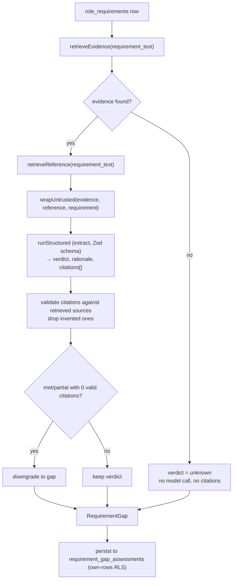

# Gap Classification (build order 10)

The classification half of the job-seeker **Evidence vs. Requirements Gap Check**. It
consumes the Evidence Search Pipeline ([ADR-0010](../adr/0010-use-pgvector-for-closed-rag-retrieval-over-reference-and-evidence.md))
and the model gateway ([ADR-0009](../adr/0009-use-openrouter-and-the-vercel-ai-sdk-as-the-model-gateway.md))
to decide, for each requirement of a user's target role, whether their evidence satisfies
it — grounded only in retrieved, cited text, and honest about gaps. The modelling decision
is recorded in [ADR-0011](../adr/0011-classify-evidence-against-role-requirements-with-a-grounded-four-verdict-schema.md).

This is **not** an agent loop. R1 (FSM/agent orchestration) is dormant until Week 6 per the
[applicability matrix](../../.claude/rules/README.md); each requirement is one structured
LLM call, or no call at all when there is no evidence.

## Verdicts

`met` · `partial` · `gap` · `unknown`

- `unknown` — no evidence retrieved; we cannot assess (set by our code, never by the model).
- `gap` — evidence retrieved but it does not cover the requirement.
- `partial` / `met` — evidence covers the requirement in part / in full, backed by a citation.

The model emits only `met | partial | gap`. Keeping `unknown` out of the model's hands is
what prevents a no-evidence requirement from being guessed into coverage.

## Flow (per requirement)

## Modules

| File | Kind | Responsibility |
|---|---|---|
| `src/lib/gap/types.ts` | pure (coverage) | Zod schemas: verdict enum, model-output schema, `RequirementGap`, assessment-row shape |
| `src/lib/gap/classify.ts` | pure + DI (coverage) | Orchestration as injected-dependency functions: no-evidence short-circuit, citation validation, downgrade, batch over requirements |
| `src/lib/llm/prompts/gap-classification.ts` | pure (coverage) | Versioned grounded `PromptDef` (`extract`), wraps untrusted inputs |
| `src/lib/gap/classifier.ts` | boundary, `server-only` (tsx test) | Wires the real `retriever`, `runStructured`, `supabaseSink`, and persistence |

Mirrors the `rag/context.ts` (pure) vs `rag/retrieve.ts` (boundary) split. No second model
path: reuses `runStructured`, `wrapUntrusted`, `llm_runs`. Retrieval and gateway are not
modified.

## Persistence

`requirement_gap_assessments` — additive table, own-rows RLS (mirrors existing policies):
`user_id`, `role_requirement_id`, `target_role_id`, `verdict`, `rationale`,
`citations jsonb`, `evidence_found bool`, `model_used`, `prompt_version`, `created_at`.
Migration is additive; `supabase db push --dry-run` is run locally only, and the hosted push
happens only on the user's explicit yes.

## Testing

Pure modules (`types.ts`, `classify.ts`, the prompt) are unit-tested with Vitest to the 80%
floor, injecting fake retrieval + fake model functions to exercise every branch (no evidence,
invented citation, downgrade, each verdict, batch). The `server-only` boundary
(`classifier.ts`) is tested via `tsx --conditions=react-server` under `tests/gap/` with a
mock Supabase + mock model, same as `tests/rag/`.

## Kanban cards

1. **ADR-0011: grounded gap-classification schema** — record the verdict taxonomy and the no-invented-coverage contract.
2. **Gap Classification core** — `gap/types.ts` + `gap/classify.ts` pure logic, test-first to the 80% floor.
3. **Gap classification prompt** — versioned grounded prompt file + tests.
4. **Gap classifier boundary** — `gap/classifier.ts` wiring retrieval + `runStructured`, tsx boundary test.
5. **Gap assessments table** — additive migration + RLS + save path (dry-run local; hosted gated).
