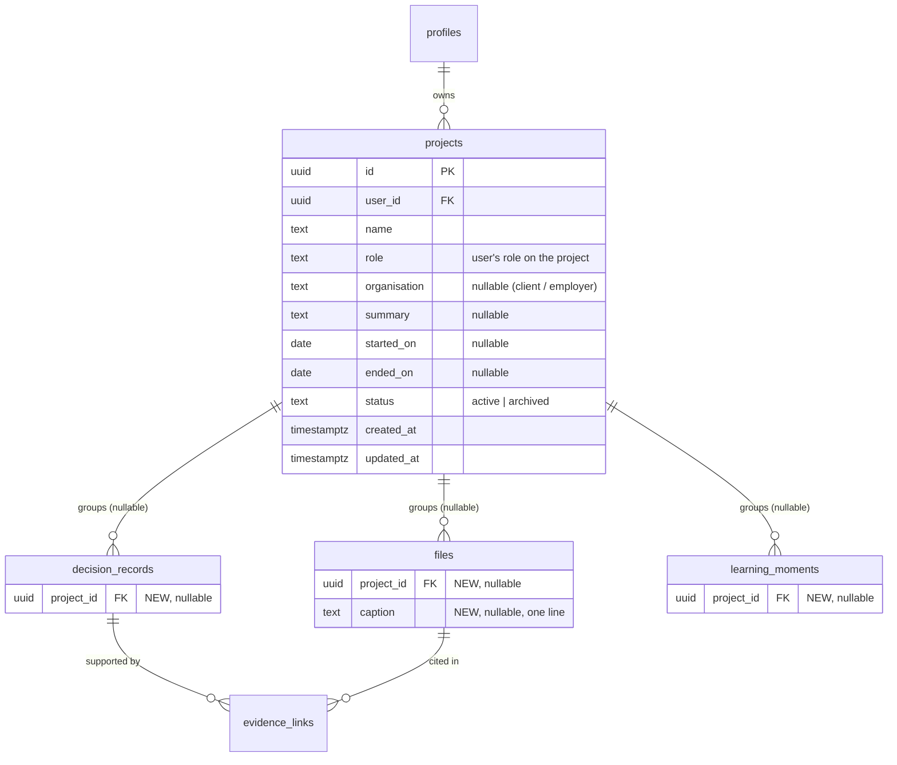

# Projects & File Detail Hub

A **Project** is a container for a real piece of work the user did — a client engagement, a
product launch, an internal initiative — and the role they played in it. This feature makes
Projects a first-class, per-user entity that the three evidence types already in the app —
**files**, **decision records**, and **learning moments** — can each be assigned to, and adds a
**file detail page** where a single uploaded file becomes a hub: a short caption, a project
assignment, and the decision records it supports.

The payoff is a **Project detail page** that gathers everything linked to one project in one
place, giving a rounded picture of what the user did on it and the role they held — which is the
whole point of a "career evidence" agent.

This is **not an agent / LLM feature.** There is no model call, no FSM, no retrieval. It is plain
relational CRUD over Supabase with Row-Level Security, so none of the R1/R3 runtime rules
(execution caps, grounding, HITL gates) are in force here. The rules that **do** apply are the
ones in force for any TypeScript written today (CLAUDE.md §3): SOLID / Humble Object (pure
mappers and validators split from thin boundary modules), and R2-as-module-boundaries — a feature
owns its data access, and **per-user ownership is enforced by RLS**, including cross-table
ownership of the new foreign key. The architecture decision (a new cross-cutting table that three
existing tables reference) is recorded in **ADR-0019**.

## What it is (and is not)

- It is an **organising layer**, not a new kind of evidence. A project holds light descriptive
  fields (name, the user's role, an optional organisation, a short summary, optional dates, a
  status) and acts as the thing files / records / moments point at. It invents no new narrative
  store.
- The file detail page follows **Fork B (hub, not duplicate).** The only narrative added to a
  **file** is a one-line `caption` ("what this deliverable is"). The heavy narrative — the user's
  role, the context, the decisions made — is **not** copied onto the file. It stays in
  **decision records**, which already model exactly that, and the file page simply lets the user
  **attach an existing record, create a new one, and assign a project**. One source of truth.
- It is **additive and non-destructive.** Every new link is a **nullable** `project_id` with
  `on delete set null`: assigning is optional, and deleting a project **detaches** its files,
  records, and moments rather than deleting them. No existing column changes meaning; no existing
  feature (interview, gap check, reviewer, investigation, claims) is touched.

## The data model

One new table and three new nullable foreign keys. Everything is per-user with own-rows RLS,
mirroring the existing schema.



**`projects`** — `id`, `user_id` (fk → `auth.users`, `on delete cascade`), `name` (not null),
`role` (nullable text — the user's role on the work), `organisation` (nullable text),
`summary` (nullable text), `started_on` / `ended_on` (nullable date), `status` (not null,
default `active`, one of `active | archived`), `created_at`, `updated_at`. Own-rows RLS (the four
select/insert/update/delete policies) plus the `set_updated_at` trigger, exactly like every
sibling table.

**`files.project_id`**, **`decision_records.project_id`**, **`learning_moments.project_id`** —
each `uuid references public.projects (id) on delete set null`, nullable, with an index. Plus
**`files.caption`** (nullable text) for Fork B.

### Cross-table ownership guard (the one security subtlety)

`project_id` is supplied by the client, so — exactly like the `evidence_links.file_id` finding
hardened in migration `20261112000019` — the existing "row's own `user_id` matches the caller"
policy is not enough: a crafted request could point a row at **another** user's project UUID.
Following the established repo pattern (a `with check … exists(…)` clause, **not** a trigger),
each of the three tables' **INSERT and UPDATE** policies is replaced to additionally require:

```sql
project_id is null
or exists (
  select 1 from public.projects p
  where p.id = project_id and p.user_id = (select auth.uid())
)
```

So you may assign a row to **no project or a project you own**, and nothing else. (RLS already
hides other users' project rows; this closes the write side too, defence in depth.)

## Modules

Mirrors the project's pure-core vs. thin-boundary split (e.g. `files/mappers.ts` +
`files/queries.ts` + `files/actions.ts`).

| File | Kind | Responsibility |
|---|---|---|
| `src/lib/projects/validation.ts` | pure (coverage) | Validate / normalise create+edit input: `name` required and length-bounded, `role` / `organisation` / `summary` bounds, `status` enum, `ended_on ≥ started_on`. Returns a typed `{ ok, value }` / `{ ok:false, error }`. |
| `src/lib/projects/mappers.ts` | pure (coverage) | `ProjectRow` → `ProjectView`; format the date range and a `linkCounts` summary for the list card. |
| `src/lib/projects/queries.ts` | thin read | `getProjects` (list, newest first), `getProject`, and `getProjectWithLinks` (the aggregation: the project + its files, decision records, and learning moments — three RLS-scoped selects on `project_id`). |
| `src/lib/projects/actions.ts` | boundary (`"use server"`) | `createProject`, `updateProject`, `deleteProject`; re-validate with `validation.ts`, throw typed domain errors (command/query separation), `revalidatePath`. |
| `src/components/ProjectPicker.tsx` | client | Reusable MUI `Select` ("No project" + the user's projects) used on the file page, the decision-record form, and the learning-moment form. Takes `projects`, `value`, `onChange`. |
| `src/lib/files/actions.ts` | boundary (extend) | Add `setFileCaption` and `setFileProject` (own-rows RLS); add attach/detach of an existing decision record via `evidence_links`, and create-record-from-file. |
| `src/lib/files/queries.ts` + `mappers.ts` | thin read / pure (extend) | Include `caption` + `project_id` in the file projection; add `getFileDetail` (file + caption + project + its linked decision records). |
| `src/components/Sidebar.tsx` | client (extend) | Add a wired **Projects** nav item (`/dashboard/projects`). |

### Pages

| Route | Kind | Shows |
|---|---|---|
| `/dashboard/projects` | Server Component + client create | List of the user's projects (name, role, org, date range, link counts) + "New project" form/dialog. |
| `/dashboard/projects/[id]` | Server Component | **The payoff page.** Project header (name, role, org, summary, dates, status, edit/delete) + three grouped sections: linked **files**, **decision records**, **learning moments**, each row deep-linking to its detail page. Empty states invite assignment. |
| `/dashboard/files/[id]` | Server Component + client panel | **The file hub.** File meta + editable `caption` + `ProjectPicker` + the list of decision records this file supports (`evidence_links`), with "attach existing record" and "create record from this file". Each file card on `/dashboard/files` links here. |

The decision-record and learning-moment create/edit forms each gain a `ProjectPicker` field so a
new record/moment can be assigned at creation time.

## Behaviour & edge cases

- **Delete a project** is a confirmed, reversible-in-spirit action: `on delete set null` detaches
  files/records/moments (they remain, unassigned). The confirm dialog says exactly that — nothing
  is destroyed but the grouping. (Contrast file delete, which is permanent.)
- **Idempotency (CLAUDE.md rule 7)** targets money-like / count-like mutations; project and
  assignment writes are neither (an absolute `set project_id = X`, naturally idempotent — the
  "Natural Idempotency" row of R2 §2.2), so no `Request ID` / dedupe table is introduced. Noted
  so the choice is explicit, not overlooked.
- **Ownership:** every read is RLS-scoped to the caller; every assignment write is guarded by the
  cross-table `with check` above. A record can never be grouped under a project the user does not
  own.
- **`learning_moments` dependency:** that table exists on `main` (migration
  `20261119050000_add_learning_moments.sql`) but **not** on this feature's current branch. The
  feature branch must be cut from `main` so the `learning_moments.project_id` foreign key has a
  target. Flagged so it is not discovered at migration time.

## Testing (TDD, 80% CI floor)

- `projects/validation.ts` — unit-tested to full branch coverage: required name, every length
  bound, `status` enum, the `ended_on ≥ started_on` rule, trimming/normalisation.
- `projects/mappers.ts` — row → view, date-range formatting (open-ended, single-date, reversed-
  guard already handled by validation), link-count formatting.
- `files/mappers.ts` — extended to assert `caption` / `project_id` pass through.
- Server Actions and queries are thin boundaries (Humble Object) covered by the existing
  integration style; the testable logic lives in the pure modules above. Overall ≥ 80% (CI gate);
  the pure validators/mappers are the high-value 100% targets.

## Kanban cards

1. **ADR-0019 — Projects as a cross-cutting entity + file-detail hub** — record the new `projects`
   table, the three nullable `project_id` FKs with `on delete set null`, the Fork-B file-hub
   decision, and the cross-table ownership guard.
2. **Projects schema migration** — one additive migration: create `projects` (+ own-rows RLS +
   `updated_at` trigger); add `project_id` to `files`, `decision_records`, `learning_moments`
   (nullable, indexed); add `files.caption`; replace those three tables' INSERT/UPDATE policies
   with the cross-table ownership `with check`. Dry-run locally; hosted push left to the user.
   **Branch must be cut from `main`** (for `learning_moments`).
3. **Projects core (validation + mappers)** — `projects/validation.ts` + `projects/mappers.ts`,
   test-first to full coverage.
4. **Projects data access + actions** — `projects/queries.ts` (incl. `getProjectWithLinks`
   aggregation) and `projects/actions.ts` (create/update/delete, typed errors, revalidate).
5. **ProjectPicker + form wiring** — reusable `ProjectPicker`; wire it into the decision-record
   and learning-moment create/edit forms (assign at creation).
6. **Projects pages + nav** — `/dashboard/projects` (list + create) and `/dashboard/projects/[id]`
   (aggregation page); add the wired **Projects** sidebar item.
7. **File detail hub** — `/dashboard/files/[id]` page + client panel: editable caption, project
   picker, linked-records list with attach-existing / create-from-file; extend `files` actions,
   queries, mappers; link file cards to the detail page.
