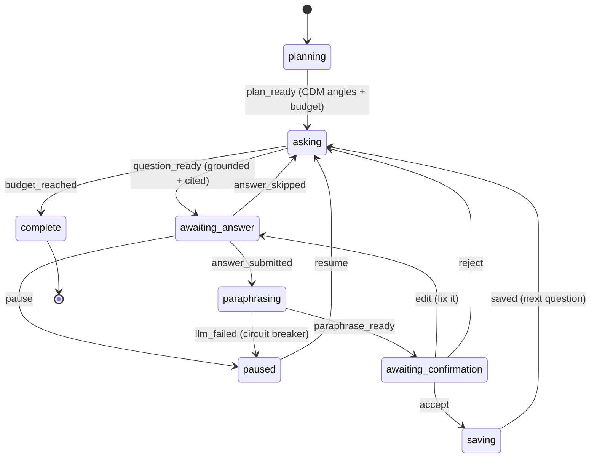

# Reasoning Interview (CDM-style decision-point interview)

The capture half of the job-seeker **Reasoning Interview & Verified Records** epic (Figma
screen "03 Reasoning interview"). It walks a user through one project at a time with
grounded, one-at-a-time questions, plays back what it understood, and — only after the user
confirms — saves a verified **decision record** in the user's own words. It consumes the
model gateway ([ADR-0009](../adr/0009-use-openrouter-and-the-vercel-ai-sdk-as-the-model-gateway.md))
and retrieval ([ADR-0010](../adr/0010-use-pgvector-for-closed-rag-retrieval-over-reference-and-evidence.md)),
and writes into the existing `decision_records` model (Decision Records & Profile Save).

**This is the first agent / multi-step loop in the app**, so it is the moment the Week-6
rules activate (CLAUDE.md §4, [applicability matrix](../../.claude/rules/README.md)): the
loop is an explicit **TypeScript finite-state machine** (not LangGraph), with hard
**step/question caps**, a **human-in-the-loop save gate**, and a **circuit breaker** — all
translated into this stack, never imported as distributed machinery. The architecture
decision is recorded in **ADR-0013**; the persistence model in **ADR-0014**.

## What it is (and is not)

- It is a **Critical Decision Method** interview: it probes one decision — the situation,
  the cue the user noticed, the decision, why, and the outcome. Those are exactly the
  columns `decision_records` already has (`situation`, `cue`, `decision`, `why`, `outcome`,
  `source`).
- It **never suggests answers.** The agent only asks and paraphrases; it never fills in
  content. Anything the user says is saved as `source = self_reported` ("your recollection")
  until a file supports it — honest provenance, mirroring the Gap Check's `unknown`.
- It is **not** a free chat and **not** autonomous: every save is gated on an explicit
  "Yes, save it", and the loop stops at a hard question budget.

## The state machine

A typed discriminated-union state plus a **pure router** `reduce(state, event) → state`.
Side effects (retrieval, model calls, DB writes) never run inside the router — the
orchestrator performs them and feeds the result back as the next event. The HITL invariant
(R1 §3.4) is structural: `saving` is a distinct state reached **only** from
`awaiting_confirmation` on `accept`, so a paraphrase prompt and a save can never share a step.

- **Guards (pure, auditable):** `budget_reached` when `asked_count ≥ question_budget`
  (default ~6, hard cap 10); `llm_failed` increments a failure counter and trips a **circuit
  breaker** after N consecutive failures, degrading to `paused` with a saved message rather
  than looping.
- **Caps:** every model call carries the gateway's R3 caps (`maxOutputTokens`, `timeoutMs`,
  ≤2 correction turns, 2 transport retries). The question budget is the loop-level cap; the
  breaker is the failure cap.

## Grounding & honesty

- **Questions** are grounded: the orchestrator calls `retriever.retrieveEvidence(topic/angle)`,
  and the question prompt cites a retrieved snippet ("Looking at slide 7 of your migration
  plan…"). With no evidence, it asks an open CDM question without inventing specifics.
- **Paraphrase** is a strict `extract` call: it maps the user's answer to the CDM draft
  fields **from their words only** (`wrapUntrusted` on evidence + answer, OWASP LLM01), never
  adding facts. The "Here's what I understood… Is that right?" card is the validation step.
- The model has **no side-effecting tools** — it returns data that is validated (Zod) and
  shown for approval before anything is written.

## Modules

| File | Kind | Responsibility |
|---|---|---|
| `src/lib/interview/types.ts` | pure (coverage) | Zod + TS: `InterviewState` union, `InterviewEvent` union, question & paraphrase (CDM draft) schemas |
| `src/lib/interview/machine.ts` | pure (coverage) | `reduce(state, event)` router + guards (budget, breaker); **no side effects** |
| `src/lib/llm/prompts/interview-question.ts` | pure (coverage) | Versioned grounded question `PromptDef` (`chat`); asks, never answers; `wrapUntrusted` |
| `src/lib/llm/prompts/interview-paraphrase.ts` | pure (coverage) | Versioned `extract` `PromptDef` → CDM draft; strictly from the user's words |
| `src/lib/interview/orchestrator.ts` | boundary, `server-only` (tsx test) | Drives the machine: retrieval, `runLLM`/`runStructured`, persistence, `saveDecisionRecord` on accept |
| `src/lib/interview/queries.ts` | thin read | Load a session + its turns (own-rows RLS) to rehydrate state |
| `src/app/dashboard/interview/` | boundary + client | Page (conversation + side panel), Server Actions (submit / skip / pause / accept / edit), client answer box + playback gate |

Mirrors the project's pure-core vs `server-only`-boundary split (`gap/classify.ts` vs
`gap/classifier.ts`). One model path only: reuses `runLLM`/`runStructured`, `wrapUntrusted`,
`llm_runs`. Retrieval, the gateway, and `decision_records` are reused unchanged; the save
goes through the existing `saveDecisionRecord`.

## Persistence (ADR-0014)

Two additive tables, own-rows RLS (mirroring existing policies), plus reuse of
`decision_records`:

- **`interview_sessions`** — `id`, `user_id`, `title` (the project/decision), `target_role_id`
  (nullable), `status` (`active | paused | complete`), `question_budget`, `asked_count`,
  `created_at`, `updated_at`.
- **`interview_turns`** — `id`, `session_id`, `user_id`, `question_text`,
  `grounding_citation jsonb` (the cited source, or null), `answer_text`, `paraphrase jsonb`
  (the CDM draft), `status` (`asked | answered | skipped | saved`), `decision_record_id`
  (nullable, set on save), `created_at`.

The session + turns **are the checkpoint** (R1 §1.4 history markers, translated): "Pause and
save" leaves the row `paused`, and resuming rehydrates the machine from the latest turn. On
"Yes, save it" the orchestrator calls the existing `saveDecisionRecord` with
`source = self_reported` and stamps `decision_record_id` on the turn. Migration is additive;
`supabase db push --dry-run` is run locally only, and the hosted push happens only on the
user's explicit yes.

## Testing

- **Pure machine** (`types.ts`, `machine.ts`) unit-tested to 100%: every transition, the
  **HITL isolation** (no path reaches `saving` except `awaiting_confirmation --accept-->`),
  the budget cap, skip/pause/resume, and the circuit breaker.
- **Prompts** tested for versioned id/semver, the "never answer / ground in cited text"
  rules, and `wrapUntrusted` wrapping.
- **Orchestrator** (`server-only`) tested via `tsx --conditions=react-server` under
  `tests/interview/` with a fake retriever, fake model, and fake repo — asserting a decision
  record is written **only after** `accept` and **never** during the paraphrase step.

## Kanban cards

1. **ADR-0013 + ADR-0014** — record the FSM + HITL + caps decision (and flip the R1/R3
   Week-6 rows to ACTIVE in the matrix + CLAUDE.md §4); record the persistence model.
2. **Interview FSM core** — `interview/types.ts` + `interview/machine.ts`, test-first to 100%
   (transitions, HITL isolation, budget cap, circuit breaker).
3. **Interview prompts** — grounded question generator + paraphrase `extract`, versioned + tests.
4. **Interview persistence** — `interview_sessions` + `interview_turns` additive migration +
   RLS + `queries.ts` (dry-run local; hosted push gated).
5. **Interview orchestrator** — `orchestrator.ts` wiring retrieval + gateway + save-on-accept,
   tsx boundary test.
6. **Interview UI** — `/dashboard/interview` page (conversation + side panel), Server Actions
   (submit / skip / pause / accept / edit), client answer box + playback gate; wire the
   "Interview" sidebar nav.
