# Reviewer Agent Check (grounded quality gate for verified records)

The **quality-gate half** of the job-seeker **Reasoning Interview & Verified Records** epic
(Epic 2). Where the [Reasoning Interview](reasoning-interview.md) *captures* a verified
**decision record** in the user's own words, the Reviewer Agent Check *examines a saved record*
before it is trusted and **flags issues** for the user — claims with no supporting evidence,
overclaiming, vagueness, or missing detail — then lets the user **accept / edit / reject** those
flags. It consumes the model gateway
([ADR-0009](../adr/0009-use-openrouter-and-the-vercel-ai-sdk-as-the-model-gateway.md)) and
closed-RAG retrieval
([ADR-0010](../adr/0010-use-pgvector-for-closed-rag-retrieval-over-reference-and-evidence.md)),
and reads the existing `decision_records` model — it adds nothing to that contract.

**This is the app's third agent / multi-step loop** (after the interview and the Evidence
Investigation Agent), so the same Week-6 rules are in force (CLAUDE.md §4,
[applicability matrix](../../.claude/rules/README.md)): the loop is an explicit **TypeScript
finite-state machine** (not LangGraph), with a hard **check/step cap**, a **circuit breaker**
on repeated model failure, **Zod** structured output, **closed-RAG citation validation**, and a
**human-in-the-loop gate** — all translated into this stack, never imported as distributed
machinery. The architecture decision is recorded in **ADR-0016**; it reuses the interview's
persistence shape by analogy (ADR-0014) with two additive tables of its own.

## What it is (and is not)

- It is a **grounded reviewer**: it checks one saved decision record against the user's **own
  uploaded evidence** (closed RAG) across a small, fixed set of **review dimensions**, and
  returns **flags** — never a rewrite. It is the counterpart to the Gap Check: Gap judges
  *evidence vs. a role requirement*; the Reviewer judges *a record vs. the evidence behind it*.
- It **never invents evidence.** A flag that asserts the record overstates or contradicts the
  evidence MUST cite really-retrieved evidence; a citation that does not point at a retrieved
  source is stripped, and an evidence-dependent flag left with no valid citation is **downgraded
  or dropped** (mirroring the Gap Check's `resolveVerdict`). "No supporting evidence on file" is
  itself an honest, grounded finding — the absence *is* the signal — not an invented citation.
- It is **not autonomous and not a rewriter.** It only observes and flags. Nothing is persisted
  and no record is marked reviewed until the user gives an explicit **accept**; the loop stops at
  a hard check budget. The user stays the author and the judge.

## The review dimensions

A fixed, ordered list — the loop runs one grounded pass per dimension, not an open-ended search:

| Dimension | Question | Grounding |
|---|---|---|
| `support` | Does a factual / metric claim in the record have supporting evidence on file? | Evidence-grounded. No evidence retrieved → one honest "no supporting evidence on file" flag, **no model call** (can't hallucinate support). |
| `accuracy` | Does the record **overstate** scope or impact beyond what the evidence shows (overclaiming / contradiction)? | Evidence-grounded. A flag **requires** a valid citation to the weaker reality; without one it is downgraded to a `support` flag. Skipped entirely when no evidence was retrieved (you cannot contradict what you cannot see). |
| `specificity` | Is the record too **vague** to be credible ("improved things a lot")? | Intrinsic to the record text; no retrieval, no evidence citation. |
| `completeness` | Is a core CDM field (situation / decision / outcome) **missing or too thin** to stand as a verified record? | Intrinsic to the record text; no retrieval, no evidence citation. |

## The state machine

A typed discriminated-union state plus a **pure router** `reduce(state, event) → state`
(`src/lib/reviewer/machine.ts`). Side effects (retrieval, model calls, DB writes) never run
inside the router — the orchestrator performs them and feeds the result back as the next event.
The HITL invariant (R1 §3.4) is structural: **`saving` — the only state that persists flags and
marks the record reviewed — is reachable ONLY from `awaiting_review` on `accept`**, so a model
pass and a persisted side effect can never share a step. This is proven by a unit test.

```mermaid
stateDiagram-v2
    [*] --> planning
    planning --> reviewing: plan_ready (dimension list + budget)
    reviewing --> reviewing: flags_ready (next dimension)
    reviewing --> awaiting_review: budget_reached (all dimensions run)
    reviewing --> paused: llm_failed (circuit breaker)
    awaiting_review --> saving: accept (persist flags + mark reviewed)
    awaiting_review --> awaiting_review: edit (change dispositions)
    awaiting_review --> discarded: reject (persist nothing trusted)
    awaiting_review --> paused: pause
    saving --> complete: saved
    paused --> reviewing: resume (checks left)
    paused --> awaiting_review: resume (checks done)
    discarded --> [*]
    complete --> [*]
```

- **Guards (pure, auditable):** `budget_reached` when `checks_done ≥ check_budget` (default 4 —
  the four dimensions — hard cap 8, clamped in `createReview`); `llm_failed` increments a failure
  counter and trips a **circuit breaker** after `BREAKER_THRESHOLD` (3) consecutive failures,
  degrading to `paused` rather than retrying forever. A successful pass resets the counter.
- **Caps:** every model call carries the gateway's R3 caps (`maxOutputTokens`, `timeoutMs`, ≤2
  correction turns, 2 transport retries) from ADR-0009 — unchanged. The check budget is the
  loop-level cap; the breaker is the failure cap; the orchestrator's `MAX_STEPS` is the
  belt-and-braces force-stop.

## Grounding & honesty

- **Evidence-grounded dimensions (`support`, `accuracy`)** retrieve the user's evidence via
  `retriever.retrieveEvidence(...)` using the record's claim-bearing text. The record and the
  retrieved evidence are `wrapUntrusted()`-wrapped (OWASP LLM01) before the model sees them. The
  model returns structured flags that may cite evidence by `source` + `id`; every citation is
  validated against what was **actually retrieved** (`validateFlagCitations`, mirroring
  `gap/classify.ts`). An `accuracy` flag with no valid citation is downgraded to a lower-severity
  `support` flag; `support` flags assert *absence* and carry no citation by nature.
- **No-evidence short-circuit:** when retrieval finds nothing, `support` emits a single
  deterministic "no supporting evidence found on file" flag **without a model call**, and
  `accuracy` is skipped — the same honesty rule the Gap Check uses for `unknown`.
- **Intrinsic dimensions (`specificity`, `completeness`)** judge the record text itself, make no
  retrieval call, and their flags carry no evidence citation — but they still go through Zod
  validation and length bounds.
- The model has **no side-effecting tools**: it returns data that is validated (Zod) and shown
  for the user's disposition before anything is written.

## Modules

| File | Kind | Responsibility |
|---|---|---|
| `src/lib/reviewer/types.ts` | pure (coverage) | Zod + TS: `ReviewState` union, `ReviewEvent` union, `ReviewFlag`, the per-dimension model-output schema, dimension / severity / disposition enums |
| `src/lib/reviewer/machine.ts` | pure (coverage) | `reduce(state, event)` router + guards (`budget_reached`, breaker); HITL isolation; **no side effects** |
| `src/lib/reviewer/grounding.ts` | pure (coverage) | `validateFlagCitations` + `resolveFlags` (downgrade/drop evidence flags with no valid citation) — mirrors the Gap Check's pure grounding logic |
| `src/lib/llm/prompts/reviewer-check.ts` | pure (coverage) | Versioned `extract` `PromptDef` → flags for one dimension; asks the model to ground in cited text; `wrapUntrusted` on record + evidence |
| `src/lib/reviewer/orchestrator.ts` | boundary, `server-only` (tsx test) | Drives the machine: retrieval, `runStructured` per dimension, persistence, **mark-reviewed + persist-flags only on accept** |
| `src/lib/reviewer/queries.ts` | thin read | Load a review + its flags + the target record (own-rows RLS) to rehydrate state and show "reviewed?" status |
| `supabase/migrations/<ts>_add_record_reviews_and_flags.sql` | migration | Two additive tables + own-rows RLS; dry-run locally only, hosted push left to the user |
| `src/app/dashboard/records/[id]/review/` | boundary + client | Page (record + flag list), Server Actions (start / accept / edit dispositions / reject / pause / resume), client disposition controls |

Mirrors the project's pure-core vs `server-only`-boundary split (`gap/classify.ts` vs
`gap/classifier.ts`, `interview/machine.ts` vs `interview/orchestrator.ts`). **One model path
only:** reuses `runStructured`, `wrapUntrusted`, `supabaseSink`, `llm_runs`. Retrieval, the
gateway, and `decision_records` are reused unchanged. **Nothing under `src/lib/investigation/**`,
`src/lib/interview/**`, or `src/lib/gap/**` is modified** — the Evidence Investigation Agent is
being built in parallel on another branch; this feature only *reads* those patterns.

## Persistence

Two additive tables, own-rows RLS (mirroring `interview_sessions` / `interview_turns`), and
**no change to `decision_records`**:

- **`record_reviews`** — `id`, `user_id`, `decision_record_id` (fk → `decision_records`,
  `on delete cascade`), `status` (`active | paused | complete | discarded`), `check_budget`
  (1–8), `checks_done` (≥ 0), `created_at`, `updated_at`.
- **`record_review_flags`** — `id`, `review_id` (fk → `record_reviews`, `on delete cascade`),
  `user_id`, `dimension` (`support | accuracy | specificity | completeness`), `severity`
  (`info | caution | serious`), `target_field` (which record field the flag is about),
  `message` (the rationale), `citations jsonb` (validated citations; `[]` for intrinsic/absence
  flags), `disposition` (`pending | accepted | dismissed`), `model_used`, `prompt_version`,
  `created_at`.

The review + its flags **are the checkpoint** (R1 §1.4 history markers, translated): a paused
review rehydrates from its row and flags, and resuming continues the remaining dimensions. A
record counts as **reviewed** when it has a `record_reviews` row with `status = complete` — the
"reviewed?" state is *derived* from this table, so `decision_records` and the claims projection
(ADR-0015) are left untouched. **Persisting the flags and marking the review complete happen only
in the `saving` state** (reached only via `accept`); `reject` closes the review as `discarded`
and persists no flags and no trust. Idempotency (CLAUDE.md rule 7): a save against an already
`complete` review is a no-op — flags are not written twice. The migration is additive;
`supabase db push --dry-run` is run locally only and the hosted push is left to the user.

## Testing

- **Pure machine** (`types.ts`, `machine.ts`) unit-tested to 100%: every transition, the
  **HITL isolation** (no path reaches `saving` except `awaiting_review --accept-->`), the check
  budget cap and hard-cap clamp, flag accumulation across dimensions, edit/reject/pause/resume,
  and the circuit breaker.
- **Grounding** (`grounding.ts`) unit-tested: citations kept only when they point at a retrieved
  source, dedup, and the downgrade/drop of an evidence flag with no valid citation.
- **Prompt** (`reviewer-check.ts`) tested for versioned id/semver, the "ground in cited text /
  never invent" rules, and `wrapUntrusted` wrapping.
- **Orchestrator** (`server-only`) tested via `tsx --conditions=react-server` under
  `tests/reviewer/` with a fake retriever, fake model, and fake repo — asserting flags are
  persisted and the record marked reviewed **only after** `accept`, **never** during a review
  pass or on `reject`, and that the no-evidence dimension makes no model call.

## Kanban cards

1. **ADR-0016 — Reviewer Agent as a grounded FSM quality gate** — record the FSM + HITL + caps +
   closed-RAG grounding decision for the third agent loop; note the two additive tables and that
   reviewed-status is derived (no `decision_records` change).
2. **Reviewer FSM core** — `reviewer/types.ts` + `reviewer/machine.ts`, test-first to 100%
   (transitions, HITL isolation, budget/hard-cap, flag accumulation, circuit breaker).
3. **Reviewer grounding** — `reviewer/grounding.ts` (`validateFlagCitations`, `resolveFlags`),
   test-first (keep-real-citations, dedup, downgrade/drop).
4. **Reviewer prompt** — versioned per-dimension `extract` prompt + tests (grounding rules,
   `wrapUntrusted`, semver).
5. **Reviewer persistence** — `record_reviews` + `record_review_flags` additive migration + RLS +
   `queries.ts` (dry-run local; hosted push gated).
6. **Reviewer orchestrator** — `orchestrator.ts` wiring retrieval + gateway per dimension +
   persist-on-accept, tsx boundary test (no write before accept; no model call with no evidence).
7. **Reviewer UI** — `/dashboard/records/[id]/review` page (record + flag list), Server Actions
   (start / accept / edit dispositions / reject / pause / resume), client disposition controls;
   wire a "Review" entry point from the record view.
